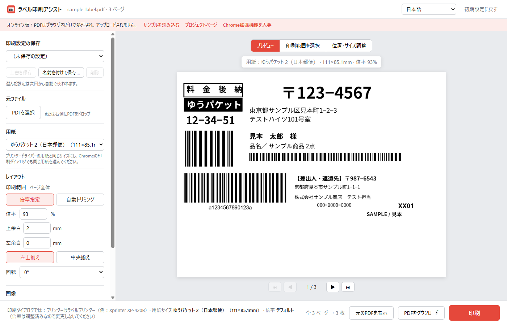

# ラベル印刷アシスト（Label Print Enhancer）

[English](README.md) · **日本語** · [中文](README.zh-CN.md)

送り状PDFを「ラベル用紙とまったく同じサイズ」のページに組み直してから、Chrome標準の印刷プレビューに渡すChrome拡張機能とWebアプリです。感熱ラベルプリンターでも一発で正しく印刷できます。

- **オンラインで試す（インストール不要）：** <https://tanktangmold.github.io/label-print-enhancer/>
- **Chrome拡張機能をダウンロード：** [GitHub Releases](https://github.com/tanktangmold/label-print-enhancer/releases/latest)

| Chromeでそのまま印刷 | 組み直した後 |
|---|---|
|  |  |

<sub>Xprinter XP-420B・用紙サイズ「ゆうパケット 2」（111 × 85 mm）・倍率「デフォルト」でのChrome印刷プレビュー。サンプルのラベルは架空のデータです。</sub>

## なぜChromeだと送り状が切れるのか

日本郵便のゆうパケットなど、多くの送り状PDFは**縦向きのページの左上にラベルが印字**されています。一方、111 × 85 mm などの感熱ラベル用紙は**横長**です。

ChromeがPDFを印刷するとき、次のことが起きます。

1. PDFでは「レイアウト（縦・横）」の設定が表示されず、常に縦向きで送られます（[`model.ts`](https://source.chromium.org/chromium/chromium/src/+/main:chrome/browser/resources/print_preview/data/model.ts)：編集できない文書ではレイアウトが無効）。
2. さらにChromeは**用紙の向きを元のページの向きに合わせて回転**します（[`pdfium_print.cc` の `SetPageSizeAndContentRect`](https://source.chromium.org/chromium/chromium/src/+/main:pdf/pdfium/pdfium_print.cc)）。その結果、横長のラベル用紙が 85 × 111 mm の縦長ページとして扱われます。
3. 倍率「デフォルト」の動きはChromeのバージョンによって違います。100%で印刷されて**ラベルの右側が切れる**か、A4ページ全体が縮小されて**ラベルがとても小さく**なります。

Chromeの標準設定をどう組み合わせても、2 は回避できません。このツールは各ページを最初から用紙と同じサイズ・向きのページに描き直すので、Chromeが回転や縮小をする余地がなくなります。

## 主な機能

- 日本郵便の送り状PDFを自動でこの画面で開き、ラベル用紙サイズに組み直します（拡張機能のみ）
- プリセット19種類：日本郵便・ヤマト・佐川・4×6インチ・100×150 mm・中国電子送り状・A4/A5/A6・B5/B6・レター・はがき、ほかにユーザー定義サイズ
- **ビジュアル選択：** 印刷したい部分をマウスで囲み、用紙の上で移動・拡大縮小。座標をリアルタイムに表示し、中央付近では自動で中央にそろいます
- **印刷設定の保存：** 設定に名前を付けて保存すると、次回から自動で使われます
- 倍率と余白（左上揃え／中央揃え）の指定、または印字部分を自動で見つけて用紙いっぱいに広げる**自動トリミング**
- 回転、解像度（203〜600 dpi）、感熱プリンター向けの**白黒2値化**
- 実際に印刷される内容をページごとにプレビュー
- すべてローカルで処理。PDFがパソコンの外に出ることはありません
- 日本語・English・中文に対応



## Chrome拡張機能のインストール

1. [Releases](https://github.com/tanktangmold/label-print-enhancer/releases/latest) から `label-print-enhancer-vX.Y.Z.zip` をダウンロードして展開します。
2. Chromeで `chrome://extensions` を開き、右上の **デベロッパー モード** をオンにします。
3. **パッケージ化されていない拡張機能を読み込む** をクリックし、展開したフォルダを選びます。
4. 必要に応じて、ツールバーに拡張機能のアイコンを固定します。

[オンライン版](https://tanktangmold.github.io/label-print-enhancer/) でもレイアウトとプレビューの機能は同じです。ただし日本郵便のPDFを自動で開くことはできないので、PDFを画面にドロップしてください。

## 使い方

- **日本郵便の送り状：** いつも通りWebサイトで送り状PDFを開くと、ラベル印刷アシストで開きます。プレビューを確認して **印刷** をクリックします。
- **そのほかのPDF：** PDFを開いた状態でツールバーのアイコンをクリックするか、PDFを画面にドロップします。
- ラベル印刷アシストの画面で `Ctrl+P` を押すと、組み直したラベルを印刷します。`←` / `→` でページを切り替えます。

Chromeの印刷ダイアログでは、最初に一度だけ次のように選んでください。Chromeが設定を覚えます。

| 項目 | 設定 |
|---|---|
| 送信先 | お使いのラベルプリンター（例：Xprinter XP-420B） |
| 用紙サイズ | ラベル印刷アシストと同じ用紙（例：ゆうパケット 2） |
| 倍率 | **デフォルト**。倍率は調整済みなので変更しないでください。 |

用紙サイズはプリンタードライバーに登録されている必要があります。ない場合は、ドライバーの印刷設定で同じ幅と高さの用紙を追加してください。

### 印刷範囲をマウスで選ぶ

1. プレビューの上の **印刷範囲を選択** をクリックします。元のページ全体が表示され、印字部分が自動で選ばれます。
2. ページ上をドラッグすると新しい枠、枠の中をドラッグすると移動、四隅をドラッグすると大きさを変えられます。X・Y・幅・高さ（mm）がリアルタイムに表示されます。
3. **決定して用紙に配置** をクリックすると、選んだ範囲が用紙いっぱいに拡大・縮小され、中央に配置されます。
4. **位置・サイズ調整** では、ドラッグで移動、四隅で拡大・縮小（縦横比は固定）、ホイールで微調整、矢印キーで微移動（Shiftで大きく）できます。位置・サイズ・倍率がリアルタイムに表示され、左右・上下の中央にそろうと赤いガイド線が出ます。**中央に配置** と **用紙に合わせる** はワンクリックです。
5. **完了** でプレビューに戻ります。全ページで選んだ範囲だけが印刷されます。

| 印刷範囲を選択 | 位置・サイズ調整 |
|---|---|
|  |  |

### 印刷設定の保存

レイアウトが決まったら、**印刷設定の保存** の **名前を付けて保存…** から名前（例：ゆうパケット送り状）を付けて保存します。選んだ設定は次にラベル印刷アシストを開いたとき自動で使われます。設定を変えると「変更あり」と表示され、**上書き保存** で更新できます。保存されるのは用紙・レイアウト・印刷範囲・回転・画像の設定で、表示言語と自動化の設定は共通です。

## 用紙プリセット

| プリセット | サイズ（mm） | 出典 |
|---|---|---|
| 日本郵便 ゆうパケット 2 / ゆうパケット | 111 × 85.1 / 111 × 169.9 | Xprinter ラベルプリンタードライバーの内蔵サイズ |
| ヤマト B2クラウド 発払い・コンパクト・ネコポス | 115.6 × 198.1 | [ヤマト B2クラウド FAQ](https://b-faq.kuronekoyamato.co.jp/app/answers/detail/a_id/1074/) |
| ヤマト B2クラウド コレクト・タイムサービス | 115.6 × 236.2 | 同上 |
| ヤマト クロネコゆうメール | 113.6 × 79.8 | 同上 |
| 佐川 e飛伝Ⅲ 統一圧着送り状 | 108.9 × 215.5 | [佐川急便 プリンタ設定マニュアル（SATO CF408T）](https://e-hiden3.sagawa-exp.co.jp/help_nsx/ehiden3_CF408T_setup.pdf) |
| 佐川 e飛伝Ⅲ サーマル荷札 | 103.9 × 144 | 同上 |
| 4×6インチ / 4×4インチ 配送ラベル | 101.6 × 152.4 / 101.6 × 101.6 | UPS・FedEx・USPS・DHL・Amazon の事実上の標準 |
| メートル法サーマルラベル | 100 × 150 | 一般的なメートル法ラベル |
| 中国 電子送り状 1枚式（標準テンプレート） | 76 × 130 | [WeChat 電子送り状 標準テンプレート](https://developers.weixin.qq.com/doc/store/supplier/api/delivery/electronic/api_ewaybill_get_template_config) |
| 中国 電子送り状 2枚式 | 100 × 180 | 菜鳥などの一般的な2枚式サイズ |
| A4 / A5 / A6・B5 / B6（JIS）・レター・はがき | 標準サイズ | ISO 216・JIS P 0138・ANSI・日本郵便 |

配送会社の仕様は変わることがあります。印刷が少しずれる場合は、ユーザー定義サイズを使うか余白を調整してください。

## 設定

| 設定 | 初期値 | 説明 |
|---|---|---|
| 用紙 | ゆうパケット 2（111 × 85.1 mm） | 印刷ダイアログで選ぶ用紙と同じにします |
| レイアウト | 倍率 93%、上余白 2 mm、左余白 0、左上揃え | 実際の日本郵便ゆうパケット送り状で確認済み |
| 自動トリミング | オフ | 印字部分を見つけて用紙いっぱいに広げます（ほかの配送会社のレイアウト向け） |
| 回転 | 0° | 元のPDFが横倒しのときに使います |
| 解像度 | 400 dpi | 203 dpi は多くの4インチ感熱プリンター本来の解像度です |
| 白黒2値化 | オン、しきい値 128 | 細い文字が薄いときはしきい値を上げます |
| 日本郵便の送り状PDFを自動で開く | オン | 拡張機能のみ |
| 自動で開いたらすぐ印刷ダイアログを表示 | オフ | 拡張機能のみ。最初に開いたときだけで、再読み込みでは表示しません |

設定と保存した印刷設定はローカルに保存されます（拡張機能は `chrome.storage`、オンライン版は `localStorage`）。

## うまくいかないとき

- **「拡張機能のファイルは更新されましたが、バックグラウンドが古いバージョンのまま」**：フォルダを上書き更新したあとに出ます。**拡張機能を再読み込み** をクリック（または `chrome://extensions` の再読み込みアイコン）。ページは自動で開き直します。それまでは「印刷」を押すと組み直したPDFが新しいタブで開くので、Ctrl+P で印刷できます。
- **「サーバーが 403 を返しました」**：PDFのリンクが期限切れか、ログインが必要です。**ChromeのPDFビューアで開く** をクリックするか、元のサイトから送り状を開き直してください。
- **「… のファイルを読む許可が必要です」**：**許可して再試行** をクリックします。確認はサイトごとに一度だけです。
- **ローカルのPDF**：画面にドロップしてください。
- **文字が薄い・太い**：しきい値か解像度を調整します。
- **全体が少しずれる**：上余白・左余白を微調整します（マイナスの値も使えます）。

## プライバシー

データがパソコンの外に送られることはありません。PDFはブラウザ内の pdf.js で描画し、組み直したPDFはChromeが印刷できるようにブラウザの IndexedDB に最長10分だけ保存します。拡張機能が初期状態でアクセスを求めるのは日本郵便の送り状配信元だけで、ほかのサイトは必要になったときに確認します。

## 開発

```bash
npm install
npm run vendor     # pdf.js / pdf-lib のビルドを lib/ にコピー
npm test           # 単体テスト（レイアウト計算・設定の検証・翻訳の抜け漏れ）
npm run e2e        # Chrome for Testing（ヘッドレス）で拡張機能のE2Eテスト
npm run e2e:web    # オンライン版のE2Eテスト（GitHub Pages と同じサブパスのローカルサーバー）
npm run e2e:visual # 範囲選択・移動/拡大縮小・中央吸着・印刷設定の保存を実際のマウス操作でテスト
npm run pages:serve   # http://127.0.0.1:8799/label-print-enhancer/ でオンライン版をプレビュー
npm run pack       # リリース用の dist/label-print-enhancer-vX.Y.Z.zip を作成
```

`node tools/print-preview-check.mjs --pdf samples/sample-label.pdf --lang ja` は別の Chrome for Testing ウィンドウを開きます。元のPDFと組み直したPDFについて、お使いのラベルプリンターで**本物の印刷プレビュー**を表示し、スクリーンショットを保存します。プレビューだけで、実際には印刷しません。E2Eスクリプトは `~/.agent-browser/browsers/chrome-152.0.7977.64/chrome.exe` の Chrome for Testing を使います。別の場所にある場合は環境変数 `CHROME_PATH` か `--chrome <パス>` で指定してください。

仕組みとファイル構成は [英語版 README](README.md#how-it-works) を参照してください。

## ライセンス

[MIT](LICENSE)。同梱ライブラリ：[pdf.js](https://github.com/mozilla/pdf.js)（Apache-2.0）、[pdf-lib](https://github.com/Hopding/pdf-lib)（MIT）。ライセンスファイルは `lib/` にあります。サンプルのラベルには [Noto Sans JP](https://fonts.google.com/noto/specimen/Noto+Sans+JP)（SIL Open Font License）のサブセットを使っています。

本プロジェクトは日本郵便・ヤマト運輸・佐川急便・Xprinter そのほかの配送会社やメーカーとは関係ありません。
