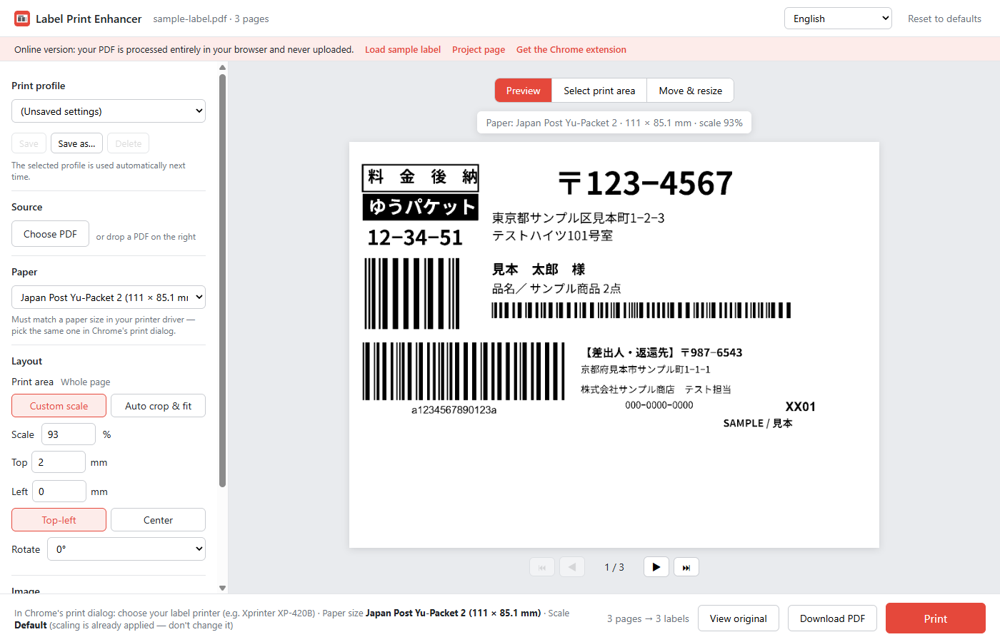

# Label Print Enhancer

**English** · [日本語](README.ja.md) · [中文](README.zh-CN.md)

A Chrome extension and web app that redraws shipping-label PDFs onto a page the exact size of your label stock, then hands them to Chrome's own print preview, so labels print right the first time on a thermal label printer.

- **Try it online (nothing to install):** <https://tanktangmold.github.io/label-print-enhancer/>
- **Download the Chrome extension:** [GitHub Releases](https://github.com/tanktangmold/label-print-enhancer/releases/latest)

| Printing directly from Chrome | After re-layout |
|---|---|
|  |  |

<sub>Chrome print preview with an Xprinter XP-420B, paper size “ゆうパケット 2” (111 × 85 mm), scale “Default”. The sample label uses fictitious data.</sub>

## Why Chrome cuts off your labels

Many shipping-label PDFs (for example Japan Post's ゆうパケット labels) are **portrait pages with the label printed in the top-left corner**, while thermal label stock such as 111 × 85 mm is **landscape**.

When Chrome prints a PDF:

1. The **Layout** (portrait/landscape) option is hidden for PDFs, and the job is always sent in portrait ([`model.ts`](https://source.chromium.org/chromium/chromium/src/+/main:chrome/browser/resources/print_preview/data/model.ts): layout is unavailable when the document is not modifiable).
2. Chrome then **rotates the paper to match the source page orientation** ([`pdfium_print.cc` `SetPageSizeAndContentRect`](https://source.chromium.org/chromium/chromium/src/+/main:pdf/pdfium/pdfium_print.cc)). The landscape label stock is treated as a portrait 85 × 111 mm page.
3. Depending on the Chrome version, scale “Default” either prints at 100% (the label is **cut off on the right**) or shrinks the whole A4 page onto the label (the label becomes **tiny**).

No combination of Chrome's built-in settings avoids step 2. This tool redraws every page onto a page that already has the same size and orientation as the paper, so Chrome has nothing to rotate and nothing to scale.

## Features

- Opens Japan Post label PDFs automatically (extension) and lays them out on your label size
- 19 paper presets: Japan Post, Yamato, Sagawa, 4×6 in, 100×150 mm, China e-waybills, A4/A5/A6, B5/B6, Letter, postcard, plus custom sizes
- **Visual selection:** draw a box around the part of the page to print, then move and resize it on the paper with live coordinates and snap-to-center
- **Print profiles:** save settings under a name and switch in one click; your last-used settings are kept for next time
- Custom scale and margins (top-left or centered), or **auto crop & fit** that finds the printed area and fills the label
- Rotation, resolution (203–600 dpi) and **pure black & white** output tuned for thermal printers
- Live preview of exactly what will be printed, page by page
- Everything runs locally: PDFs never leave your computer
- UI in English, 日本語 and 中文



## Install the Chrome extension

1. Download `label-print-enhancer-vX.Y.Z.zip` from [Releases](https://github.com/tanktangmold/label-print-enhancer/releases/latest) and unzip it.
2. Open `chrome://extensions` and turn on **Developer mode** (top right).
3. Click **Load unpacked** and select the unzipped folder.
4. Optional: pin the extension icon to the toolbar.

The [online version](https://tanktangmold.github.io/label-print-enhancer/) has the same layout and preview features. It cannot open Japan Post PDFs automatically; drop the PDF onto the page instead.

## Usage

- **Japan Post labels:** open the label PDF from the website as usual. The extension opens it in Label Print Enhancer. Check the preview and click **Print**.
- **Any other PDF:** click the toolbar icon while the PDF is open, or drop a PDF onto the page.
- `Ctrl+P` on the Label Print Enhancer page prints the re-laid-out labels. `←` / `→` change pages.

In Chrome's print dialog, choose the following once. Chrome remembers them.

| Setting | Value |
|---|---|
| Destination | your label printer (e.g. Xprinter XP-420B) |
| Paper size | the same paper as in Label Print Enhancer (e.g. ゆうパケット 2) |
| Scale | **Default**. The scale is already applied, so don't change it. |

The paper size must exist in your printer driver. If it doesn't, add it in the driver's printing preferences with the same width and height.

### Select the print area visually

1. Click **Select print area** above the preview. The whole source page is shown and the printed area is detected automatically.
2. Drag on the page to draw a new box, drag inside the box to move it, or drag the corners to resize it. X / Y / W / H (mm) are shown live.
3. Click **Done — place on paper**. The selection is scaled to fill the paper and centered.
4. In **Move & resize**, drag the content, drag a corner to scale it (aspect ratio is kept), scroll to fine-tune the size, or use the arrow keys (Shift = bigger steps). The position, size and scale are shown live, and red guides appear when it snaps to the horizontal or vertical center. **Center** and **Fit to paper** do it in one click.
5. Click **Done** to return to the preview. Only the selected area is printed, on every page.

| Select print area | Move & resize |
|---|---|
|  |  |

### Print profiles

Once the layout is right, click **Save as…** under **Print profile** and give it a name (for example “Yu-Packet label”). Picking a profile applies it. Your last-used settings — including the selected profile and any changes you made afterwards — are kept for next time; the panel shows *Modified* when they differ from the profile, and **Save** writes them into it. Pick the profile again to go back to its saved state. Profiles store the paper, layout, print area, rotation and image settings; the UI language and automation options stay global.

## Paper presets

| Preset | Size (mm) | Source |
|---|---|---|
| Japan Post ゆうパケット 2 / ゆうパケット | 111 × 85.1 / 111 × 169.9 | Built-in sizes of the Xprinter label-printer driver |
| Yamato B2 Cloud – prepaid / Compact / Nekopos | 115.6 × 198.1 | [Yamato B2 Cloud FAQ](https://b-faq.kuronekoyamato.co.jp/app/answers/detail/a_id/1074/) |
| Yamato B2 Cloud – Collect / Time Service | 115.6 × 236.2 | same |
| Yamato Kuroneko Yu-Mail | 113.6 × 79.8 | same |
| Sagawa e-Hiden III – unified pressure-seal waybill | 108.9 × 215.5 | [Sagawa printer setup manual (SATO CF408T)](https://e-hiden3.sagawa-exp.co.jp/help_nsx/ehiden3_CF408T_setup.pdf) |
| Sagawa e-Hiden III – thermal tag | 103.9 × 144 | same |
| 4×6 in / 4×4 in shipping label | 101.6 × 152.4 / 101.6 × 101.6 | De facto standard for UPS, FedEx, USPS, DHL, Amazon |
| Metric thermal label | 100 × 150 | Common metric label size |
| China e-waybill, 1-ply (standard template) | 76 × 130 | [WeChat e-waybill standard template](https://developers.weixin.qq.com/doc/store/supplier/api/delivery/electronic/api_ewaybill_get_template_config) |
| China e-waybill, 2-ply | 100 × 180 | Common Cainiao 2-ply size |
| A4 / A5 / A6, B5 / B6 (JIS), US Letter, Japanese postcard | standard sizes | ISO 216, JIS P 0138, ANSI, Japan Post |

Carrier specifications can change. If your printout is slightly off, use the custom size or adjust the margins.

## Settings

| Setting | Default | Notes |
|---|---|---|
| Paper | ゆうパケット 2 (111 × 85.1 mm) | Must match the paper you pick in Chrome's print dialog |
| Layout | Custom scale 93%, top 2 mm, left 0, top-left | Tested on real Japan Post ゆうパケット labels |
| Auto crop & fit | off | Finds the printed area and fills the label (good for other carriers' layouts) |
| Rotate | 0° | Use it if the source PDF is sideways |
| Resolution | 400 dpi | 203 dpi is the native resolution of most 4-inch thermal printers |
| Pure black & white | on, threshold 128 | Raise the threshold if thin text looks faint |
| Open Japan Post PDFs automatically | on | Extension only |
| Show the print dialog right after opening | off | Extension only. Only fires on the first open, not on reload. |

Settings and profiles are saved locally (`chrome.storage` in the extension, `localStorage` online).

## Troubleshooting

- **“The extension files were updated, but its background is still running the old version”**: after updating the unpacked folder in place, click **Reload extension** (or the reload icon in `chrome://extensions`). The page reopens automatically. Until then, Print opens the re-laid-out PDF in a new tab so you can still print it with Ctrl+P.
- **“Server returned 403”**: the PDF link has expired or needs a login. Click **Open in Chrome's PDF viewer** or reopen the label from the original site.
- **“Permission is needed to read files from …”**: click **Allow and retry**. Chrome asks once per site.
- **Local PDFs**: drop them onto the page.
- **Text too light or too bold**: adjust the threshold or the resolution.
- **Everything is shifted a little**: fine-tune the top/left margins (negative values are allowed).

## Privacy

No data leaves your computer. PDFs are rendered with pdf.js in your browser, and the re-laid-out PDF is kept in the browser's IndexedDB for up to 10 minutes so Chrome can print it. The extension only requests access to Japan Post's label host by default. Other sites are requested when you need them.

## Development

```bash
npm install
npm run vendor     # copy pdf.js / pdf-lib builds into lib/
npm test           # unit tests (layout math, settings validation, i18n completeness)
npm run e2e        # extension end-to-end test in Chrome for Testing (headless)
npm run e2e:web    # web version end-to-end test (local server with the GitHub Pages sub-path)
npm run e2e:visual # visual selection, move/resize, snap-to-center and print profiles with real mouse events
npm run e2e:profiles # switching profiles, keeping last-used settings across reloads
npm run pages:serve   # preview the web version at http://127.0.0.1:8799/label-print-enhancer/
npm run pack       # build dist/label-print-enhancer-vX.Y.Z.zip for a release
```

`node tools/print-preview-check.mjs --pdf samples/sample-label.pdf --lang en-US` opens a separate Chrome for Testing window, triggers the **real print preview** for the original and re-laid-out PDF with your label printer, and saves screenshots. It only previews and never prints. The e2e scripts expect Chrome for Testing at `~/.agent-browser/browsers/chrome-152.0.7977.64/chrome.exe`; set `CHROME_PATH` or pass `--chrome <path>` to use another one.

### How it works

```
PDF ──pdf.js──▶ canvas the size of the paper (scale, margins, rotation, black & white)
    ──pdf-lib──▶ new PDF whose pages = paper size (1-bit image per page)
    ──IndexedDB + service worker──▶ same-origin URL ──hidden iframe──▶ Chrome print preview
```

A `blob:` URL can't be used, because a PDF loaded from `blob:` in an iframe counts as cross-origin and `print()` is blocked. A service worker (`background.js` in the extension, `sw.js` online) serves the file from IndexedDB at `generated/…` instead.

```
manifest.json, background.js   extension: auto-open Japan Post PDFs, toolbar button, serve generated PDFs
viewer.html, viewer/           the layout page (shared by the extension and the web version)
core/                          layout math, settings, i18n, storage, platform detection, output storage
i18n/                          en / ja / zh strings
index.html, site.*, sw.js      GitHub Pages home page and web-version service worker
tools/                         vendor, sample/fixture generators, e2e tests, Pages build/deploy, pack
```

## License

[MIT](LICENSE). Bundled libraries: [pdf.js](https://github.com/mozilla/pdf.js) (Apache-2.0) and [pdf-lib](https://github.com/Hopding/pdf-lib) (MIT). Their license files are in `lib/`. The sample label uses a subset of [Noto Sans JP](https://fonts.google.com/noto/specimen/Noto+Sans+JP) (SIL Open Font License).

This project is not affiliated with Japan Post, Yamato Transport, Sagawa Express, Xprinter or any other carrier or vendor.
