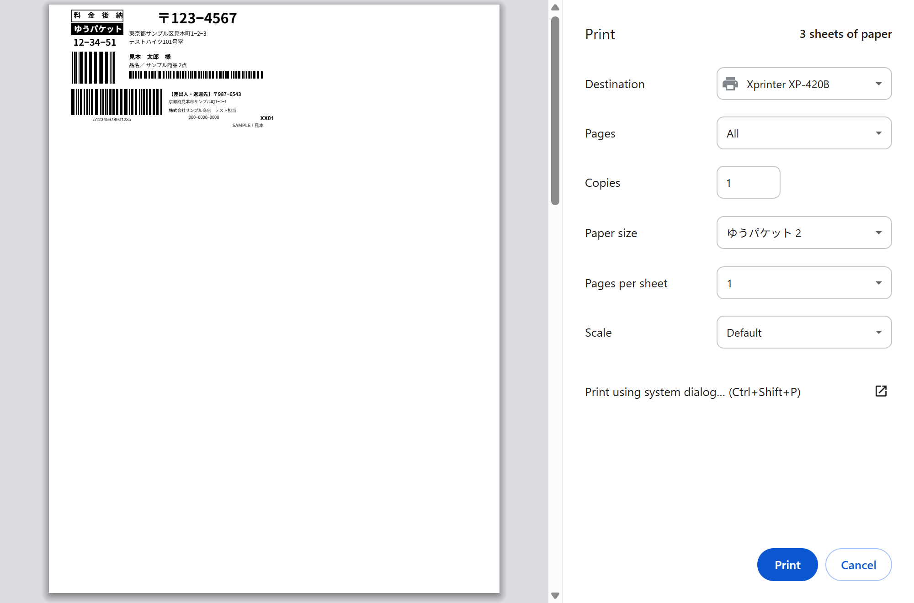
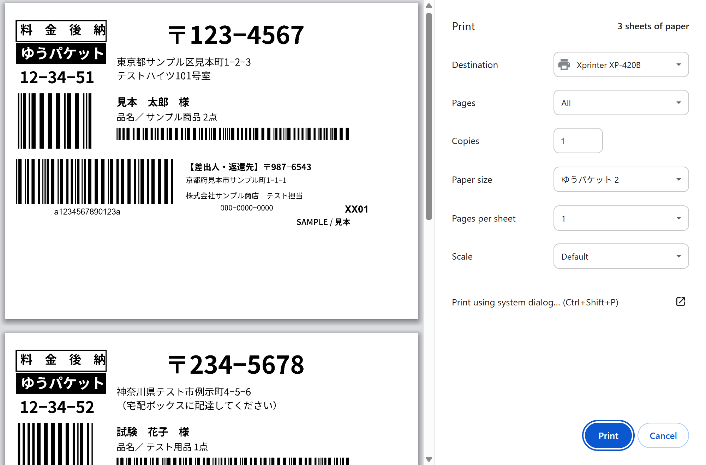
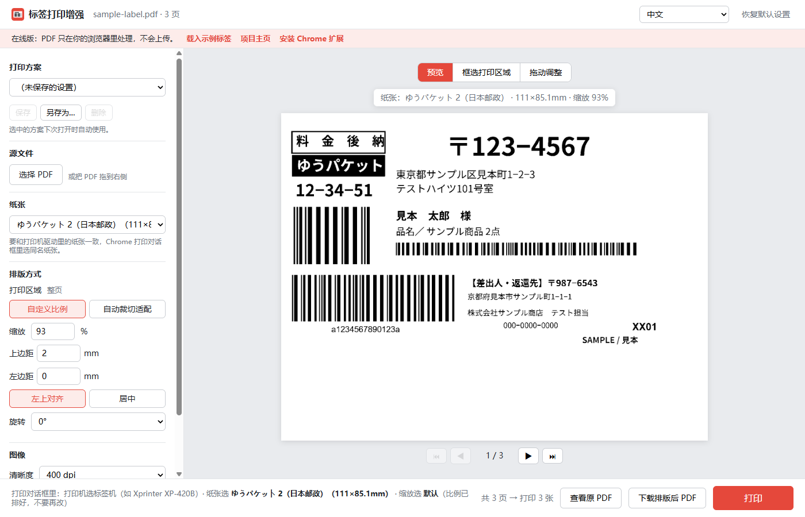
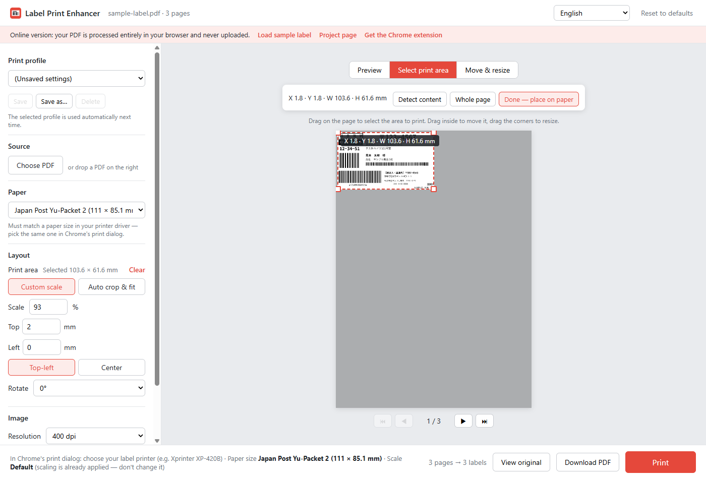
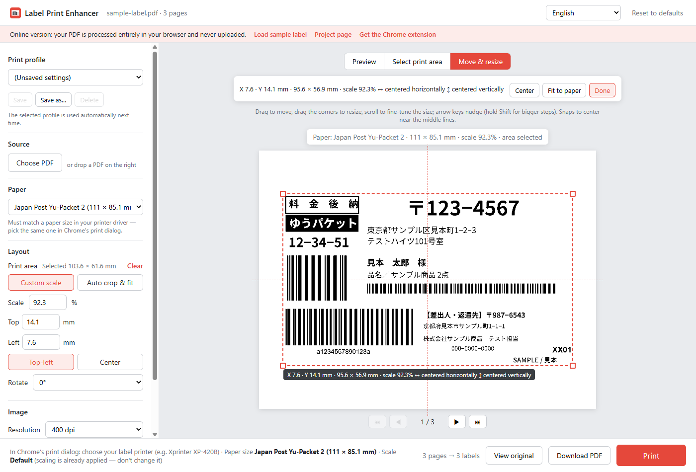

# 标签打印增强（Label Print Enhancer）

[English](README.md) · [日本語](README.ja.md) · **中文**

这是一个 Chrome 扩展，也有网页版。它先把快递面单 PDF 重新排到「和标签纸一样大」的页面上，再交给 Chrome 自带的打印预览，用热敏标签机也能一次打对。

- **在线试用（不用安装）：** <https://tanktangmold.github.io/label-print-enhancer/>
- **下载 Chrome 扩展：** [GitHub Releases](https://github.com/tanktangmold/label-print-enhancer/releases/latest)

| 直接用 Chrome 打印 | 排版后 |
|---|---|
|  |  |

<sub>Chrome 打印预览：Xprinter XP-420B、纸张「ゆうパケット 2」（111 × 85 mm）、缩放「默认」。示例标签为虚构数据。</sub>

## 为什么 Chrome 打印会切掉标签

很多快递面单 PDF（比如日本邮政的 ゆうパケット 送り状）是**竖版页面，标签印在左上角**；而 111 × 85 mm 这类热敏标签纸是**横的**。

Chrome 打印 PDF 时：

1. PDF 没有「布局（纵向/横向）」选项，固定按纵向发送（[`model.ts`](https://source.chromium.org/chromium/chromium/src/+/main:chrome/browser/resources/print_preview/data/model.ts)：不可编辑的文档布局不可用）。
2. Chrome 还会**把纸张转成和源页面同方向**（[`pdfium_print.cc` 的 `SetPageSizeAndContentRect`](https://source.chromium.org/chromium/chromium/src/+/main:pdf/pdfium/pdfium_print.cc)），横向标签纸被当成 85 × 111 mm 的竖页。
3. 缩放「默认」在不同 Chrome 版本里表现不同：要么按 100% 打印，**标签右边被切掉**；要么把整张 A4 缩进标签纸，**标签变得很小**。

Chrome 自带的选项怎么组合都绕不过第 2 步。本工具把每一页直接画到和纸张同尺寸、同方向的页面上，Chrome 就没有可转、可缩的了。

## 功能

- 自动接管日本邮政送り状 PDF，打开即排成标签纸大小（仅扩展）
- 19 种纸张预设：日本邮政、雅玛多、佐川、4×6 英寸、100×150 mm、中国电子面单、A4/A5/A6、B5/B6、Letter、明信片，另可自定义尺寸
- **可视化选区：** 用鼠标框出要打印的区域，再到纸上拖动、缩放，实时显示坐标，靠近中线自动吸附居中
- **打印方案：** 给设置起名保存，选中的方案下次打开自动套用
- 自定义比例和边距（左上对齐/居中），或**自动裁切适配**：自动找出有内容的区域铺满标签
- 旋转、清晰度（203–600 dpi）、为热敏打印机准备的**黑白二值化**
- 逐页预览实际打印出来的样子
- 全部在本机处理，PDF 不会离开你的电脑
- 中文 / English / 日本語 界面



## 安装 Chrome 扩展

1. 从 [Releases](https://github.com/tanktangmold/label-print-enhancer/releases/latest) 下载 `label-print-enhancer-vX.Y.Z.zip` 并解压。
2. Chrome 打开 `chrome://extensions`，打开右上角「**开发者模式**」。
3. 点「**加载已解压的扩展程序**」，选择解压出的文件夹。
4. 可以把扩展图标固定到工具栏，方便以后用。

[在线版](https://tanktangmold.github.io/label-print-enhancer/)的排版和预览功能一样，只是不能自动接管日本邮政的 PDF，需要把 PDF 拖进页面。

## 使用

- **日本邮政送り状：** 照常在网站上打开送り状 PDF，会自动用「标签打印增强」打开。看一眼预览，点「**打印**」。
- **其他 PDF：** 打开 PDF 后点工具栏图标，或把 PDF 拖进页面。
- 在「标签打印增强」页面按 `Ctrl+P` 打印的是排版后的标签；`←` / `→` 翻页。

Chrome 打印对话框第一次这样选，之后 Chrome 会记住：

| 项目 | 选择 |
|---|---|
| 目标打印机 | 你的标签打印机（如 Xprinter XP-420B） |
| 纸张尺寸 | 和「标签打印增强」里一样的纸张（如 ゆうパケット 2） |
| 缩放 | **默认**。比例已经排好了，不要再改 |

打印机驱动里必须有这个纸张尺寸。如果没有，在驱动的「打印首选项」里按同样的宽高新建一个。

### 用鼠标框选打印区域

1. 点预览上方的「**框选打印区域**」，会显示整张原页面，并自动识别出有内容的区域。
2. 在页面上拖动可以画新框，拖框内移动，拖四角调整大小，实时显示 X / Y / 宽 / 高（mm）。
3. 点「**完成，排到纸上**」，选中的区域会等比铺满纸张并居中。
4. 在「**拖动调整**」里：拖动内容移动，拖四角等比缩放，滚轮微调大小，方向键微移（按住 Shift 移得更多）。实时显示位置、大小和缩放比例，水平/垂直居中时出现红色辅助线并自动吸附。「**居中**」「**铺满纸张**」一键完成。
5. 点「**完成**」回到预览。每一页都只打印选中的区域。

| 框选打印区域 | 拖动调整 |
|---|---|
|  |  |

### 打印方案

排好以后，在「**打印方案**」里点「**另存为…**」起个名字（比如「ゆうパケット送り状」）。选中的方案下次打开「标签打印增强」时自动套用；改了设置会提示「已修改」，点「**保存**」更新方案。方案保存的是纸张、排版、打印区域、旋转和图像设置；界面语言和自动化选项是全局的。

## 纸张预设

| 预设 | 尺寸（mm） | 出处 |
|---|---|---|
| 日本邮政 ゆうパケット 2 / ゆうパケット | 111 × 85.1 / 111 × 169.9 | Xprinter 标签机驱动内置尺寸 |
| 雅玛多 B2クラウド 寄付·コンパクト·ネコポス | 115.6 × 198.1 | [雅玛多 B2クラウド FAQ](https://b-faq.kuronekoyamato.co.jp/app/answers/detail/a_id/1074/) |
| 雅玛多 B2クラウド 代收·时间指定 | 115.6 × 236.2 | 同上 |
| 雅玛多 クロネコゆうメール | 113.6 × 79.8 | 同上 |
| 佐川 e飛伝Ⅲ 统一压着送り状 | 108.9 × 215.5 | [佐川打印机设置手册（SATO CF408T）](https://e-hiden3.sagawa-exp.co.jp/help_nsx/ehiden3_CF408T_setup.pdf) |
| 佐川 e飛伝Ⅲ 热敏荷札 | 103.9 × 144 | 同上 |
| 4×6 英寸 / 4×4 英寸 面单 | 101.6 × 152.4 / 101.6 × 101.6 | UPS、FedEx、USPS、DHL、亚马逊通用的事实标准 |
| 公制热敏面单 | 100 × 150 | 常见公制标签尺寸 |
| 中国一联电子面单（标准模板） | 76 × 130 | [微信电子面单标准模板](https://developers.weixin.qq.com/doc/store/supplier/api/delivery/electronic/api_ewaybill_get_template_config) |
| 中国二联电子面单 | 100 × 180 | 菜鸟等常见二联单尺寸 |
| A4 / A5 / A6、B5 / B6（JIS）、Letter、日本明信片 | 标准尺寸 | ISO 216、JIS P 0138、ANSI、日本邮政 |

快递公司的规格可能会变。打出来有轻微偏差时，用自定义尺寸或调边距即可。

## 设置说明

| 设置 | 默认 | 说明 |
|---|---|---|
| 纸张 | ゆうパケット 2（111 × 85.1 mm） | 要和打印对话框里选的纸张一致 |
| 排版方式 | 自定义比例 93%，上边距 2 mm、左边距 0、左上对齐 | 已用真实的日本邮政 ゆうパケット 送り状验证 |
| 自动裁切适配 | 关 | 找出有内容的区域铺满标签，适合其他快递公司的版式 |
| 旋转 | 0° | 源 PDF 方向不对时用 |
| 清晰度 | 400 dpi | 203 dpi 是多数 4 英寸热敏打印机的原生分辨率 |
| 黑白二值化 | 开，阈值 128 | 细字偏淡就调高阈值 |
| 打开日本邮政送り状 PDF 时自动用本页排版 | 开 | 仅扩展 |
| 自动接管后直接弹出打印对话框 | 关 | 仅扩展；只在第一次打开时弹出，刷新不会再弹 |

设置和打印方案保存在本机（扩展用 `chrome.storage`，在线版用 `localStorage`）。

## 出问题怎么办

- **「扩展文件已更新，但后台还在运行旧版本」**：直接覆盖更新了扩展文件夹后会出现。点「**重新加载扩展**」（或在 `chrome://extensions` 点刷新图标），页面会自动重新打开。在这之前点「打印」会在新标签打开排版后的 PDF，按 Ctrl+P 照样能打。
- **「服务器返回 403」**：PDF 链接过期或需要登录。点「**用 Chrome 原生查看器打开**」，或回原网站重新打开送り状。
- **「需要授权读取 … 上的文件」**：点「**授权并重试**」，每个网站只问一次。
- **本地 PDF**：直接拖进页面。
- **字迹偏淡/偏粗**：调浓淡阈值或清晰度。
- **整体略有偏移**：微调上/左边距（可以填负数）。

## 隐私

数据不会离开你的电脑。PDF 由浏览器里的 pdf.js 渲染；排版后的 PDF 为了让 Chrome 打印，会在浏览器的 IndexedDB 里最多保存 10 分钟。扩展默认只申请日本邮政面单网址的访问权限，其他网站在需要时才询问。

## 开发

```bash
npm install
npm run vendor     # 把 pdf.js / pdf-lib 拷进 lib/
npm test           # 单元测试（排版计算、设置校验、翻译是否齐全）
npm run e2e        # 用 Chrome for Testing（无头）跑扩展端到端测试
npm run e2e:web    # 在线版端到端测试（本地服务，路径和 GitHub Pages 一样）
npm run e2e:visual # 用真实鼠标事件测试框选、拖动缩放、居中吸附、打印方案
npm run pages:serve   # 在 http://127.0.0.1:8799/label-print-enhancer/ 预览在线版
npm run pack       # 生成发布用的 dist/label-print-enhancer-vX.Y.Z.zip
```

`node tools/print-preview-check.mjs --pdf samples/sample-label.pdf --lang zh-CN` 会另开一个 Chrome for Testing 窗口，用你的标签打印机对「原 PDF」和「排版后」各弹一次**真的打印预览**并截图。只看预览，不会真的打印。端到端脚本默认使用 `~/.agent-browser/browsers/chrome-152.0.7977.64/chrome.exe` 的 Chrome for Testing，在别处可以用环境变量 `CHROME_PATH` 或 `--chrome <路径>` 指定。

工作原理和文件结构见[英文 README](README.md#how-it-works)。

## 许可证

[MIT](LICENSE)。内置的库：[pdf.js](https://github.com/mozilla/pdf.js)（Apache-2.0）和 [pdf-lib](https://github.com/Hopding/pdf-lib)（MIT），许可证文件在 `lib/` 里。示例标签使用了 [Noto Sans JP](https://fonts.google.com/noto/specimen/Noto+Sans+JP)（SIL Open Font License）的子集。

本项目与日本邮政、雅玛多运输、佐川急便、Xprinter 以及其他快递公司或厂商均无关联。
